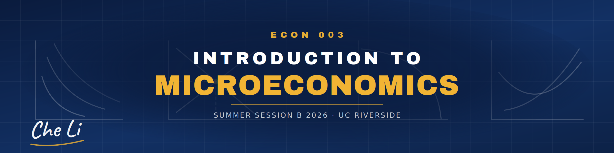

# ECON 003 — Introduction to Microeconomics (UC Riverside, Summer B 2026)

Course materials I built and taught as instructor of record: an online, asynchronous five-week course for about 80 students, two textbook chapters a week.

**Textbook:** Acemoglu, Laibson & List, *Microeconomics* (3e). Homework and quizzes ran on Pearson MyLab.

## What's here

| Folder | Contents |
|---|---|
| [`slides/`](slides) | Ten chapter decks as delivered to students (PowerPoint + PDF): Ch. 1, 3, 4, 5, 6, 7, 8, 9, 10, 12. Plus the Ch. 13 sample deck that set the house style |
| [`art/`](art) | The slide image system: chapter cover art, a 30-icon library, the course banner, and the art-direction pack (templates × styles, prompts, palette) |
| [`website/`](website) | The Canvas course homepage, hand-written in HTML, plus the reusable template |
| [`syllabus/`](syllabus) | The syllabus (Word + PDF) and an as-delivered record of how the course actually ran |
| [`exams/study-guides/`](exams/study-guides) | Midterm and final study guides |
| [`tools/deck-build/`](tools/deck-build) | Python/JS scripts that built the decks: animated diagrams, chart generation, cover art, layout and fit checks |
| [`tools/exam-build/`](tools/exam-build) | The exam pipeline: extract items from the publisher bank, classify and tier them, select a 150-item pool, cost exam time, export Canvas QTI banks. See its [README](tools/exam-build/README.md) |
| [`tools/video/`](tools/video) | PowerShell + ffmpeg scripts for cutting, splitting and merging lecture recordings without re-encoding |

## How the course was built

- **Decks:** built in the UCR blue/gold template, then animated diagram by diagram (supply/demand shifts, surplus areas, tax wedges) by the scripts in `tools/deck-build`. Publisher activities designed for live classrooms were cut, so the recorded lectures run straight through.
- **Images:** generated under one art system (five templates × five styles, a flat editorial vector as the house style, at most two styles per lecture). The full system is in [`art/ECON003_course_art_pack.md`](art/ECON003_course_art_pack.md).
- **Exams:** each student drew 50 questions from a 150-item pool split into routine and challenging tiers per chapter. The pool mixed reused homework/quiz items, publisher-bank items and original questions. Every item was read and timed, and full draws were simulated to keep working time at 70–80 minutes.
- **Lectures:** recorded section by section and assembled with the scripts in `tools/video`.

## Not included

- **Student data:** grades, evaluations and anything else about individual students.
- **Publisher material:** Pearson's slide decks, MyLab homework and quiz printouts, and the exam question pools and answer keys, which are largely Pearson items.
- **Third-party material:** UCR logos and PowerPoint templates, and the ffmpeg binaries (download ffmpeg from <https://ffmpeg.org>).
- **Lecture videos.**
- **Contact details:** TA names and contact details, and my Zoom link, are removed from the public copy of the syllabus and homepage.

© 2026 Che Li.
